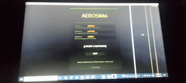
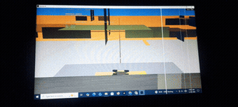
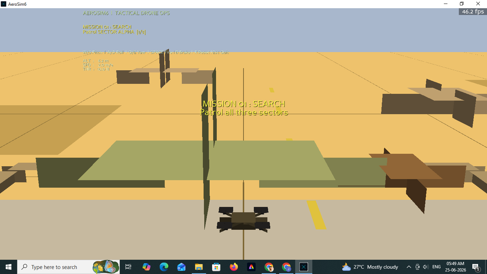

# AeroSim6 

**Tactical Drone Operations Simulator** — built from scratch in Python using the Panda3D game engine.

AeroSim6 puts you in control of a reconnaissance and strike drone across a three-mission desert campaign, combining realistic 6-degree-of-freedom flight dynamics with mission-driven objectives and a full instrument HUD — all built solo, from physics to mission architecture to rendering.

## 🎮 Campaign

| Mission | Objective |
|---|---|
| **01 — SEARCH** | Patrol three sectors and locate enemy activity across the desert terrain |
| **02 — LOCATE** | Scan suspect sites to uncover the position of a hidden enemy base |
| **03 — STRIKE** | Eliminate all designated targets and return safely to base |

## ✨ Features

- **Realistic 6-DOF flight physics** with quaternion-based orientation
- **Full pilot HUD** — live altitude, speed, thrust, and mission objectives
- **Dynamic chase camera** that follows the drone through every maneuver
- **Collision detection and emergency braking** for tighter tactical control
- **Desert military environment** with structures, cover, and sector-based navigation
- **Mission-based progression** with retry and game-over handling

## 🕹️ Controls

| Key | Action |
|---|---|
| `W` / `S` | Pitch (nose down / up) |
| `A` / `D` | Roll (left / right) |
| `Q` / `E` | Yaw (left / right) |
| `SPACE` | Fire weapon (Mission 3) |
| `B` | Emergency brake |
| `R` | Reset drone |
| `ESC` | Quit |

> Thrust auto-hovers — use pitch and roll to translate through the battlespace.

## 🛠️ Tech Stack

- **Language:** Python
- **Engine:** Panda3D
- **Physics:** Custom 6-DOF flight model with quaternion-based orientation
- **Packaging:** PyInstaller (standalone Windows executable)

## 🧠 About the Project

AeroSim6 was built as a solo project exploring real-time flight dynamics, mission system architecture, and 3D simulation development in Python — from procedural geometry and synthesized audio to a custom HUD and packaged executable. It's an ongoing build; feedback and bug reports are welcome.

## 📥 Download

Play it on itch.io: **[jyotirmoy32.itch.io/aerosim6](https://jyotirmoy32.itch.io/aerosim6)**

*(Windows only)*

## 📸 Screenshots

**Main menu**

**Mission start transition**

**Mission 01 — SEARCH, in-flight HUD**

## 🚧 Roadmap

- [ ] Additional missions
- [ ] Expanded environments
- [ ] Refined flight tuning based on player feedback

## 📄 License

All Rights Reserved

